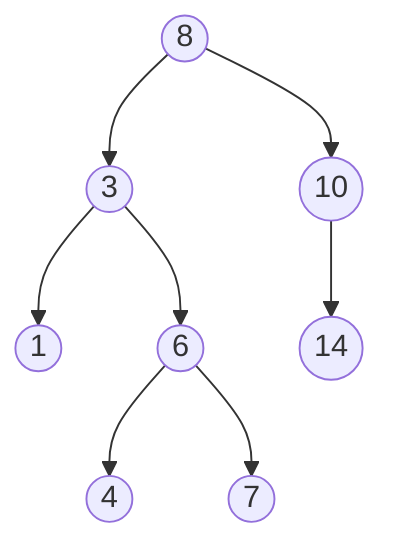
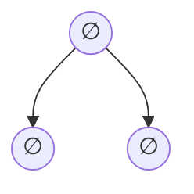

# BST
A [[binary search tree]] (Also known as sorted binary tree, the combination of these two names explain what it does pretty well)
A BST is a [[binary tree]] but with the following property:
For each node $v$, every value in the left sub-tree of $v$ is lesser or equal to $v$, and every value in the right sub-tree of $v$ is greater or equal to $v$. 
This means that the elements of a BST need to have some sort of a partial order (explained [[תואר/סיכומים/סמסטר א/מושגי יסוד במתמטיקה/הרצאה 12#יחסי סדר|here]])
# Implementation in Scheme
By an arbitrary decision, equal values will go the the right sub-tree.
Since we have [[Scheme Glossary#Pairs|only one data structure]], we'll build it with pairs.
A tree will be represented as follows
```scheme
(v l r)
```
Where `v` is the value, `l` is the left sub-tree and `r` is the right sub-tree
So for example the tree

It will be
```scheme
(8 (3 (1) (6 (4)) (7))) (10 () (14)))
```

Since we need the tree to be ordered, a null value is not acceptable so I have decided that the empty pair `()` will represent an empty value. So the empty tree will be
`(() () ())`

Since having a child of empty value is not the same as not having a child, said empty tree is


> [!WARNING] Depth
> This might make it seem like there is a level after the leaves, don't let this confuse you.

## Operations
### Traversal
There are three main ways to traverse a binary search tree, pre-order, in-order and post-order.
The three traversal algorithms are very similar.
Start at the root node, then Visit nodes in a pattern (the only difference between the algorithms is the pattern), and for each node visited, treat it as the root of its own sub-tree, and apply the algorithm on it.

In pre-order you go through the the node, the left sub-tree and then the right sub-tree
In in-order you go through the left sub-tree, the node and then the right sub-tree
In post-order you go through the right sub-tree, the right sub-tree and then the node.

An inorder traversal visits the node in a non-decreasing order.
Traversals are $\Theta \left( n \right)$ where $n$ is the number of nodes.
### Insertion
New values are added as leaves, to find *where* to put the new values.
To insert the value $v$,  we start at the root, if the value of the root is greater than $v$ we go the the left sub-tree, else we go the the right.
When we get to a leaf (which can be true for the root node itself), we create a node with value $v$ and insert it as the left or the right sub-tree.
### Removal
