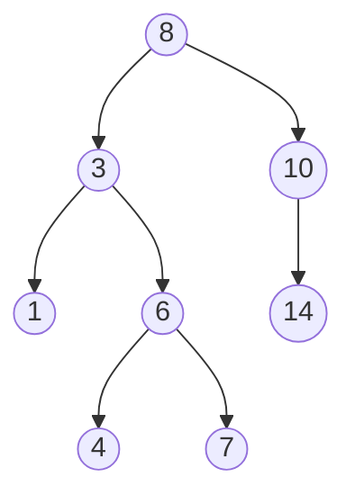

# BST
A [[binary search tree]] (Also known as sorted binary tree, the combination of these two names explain what it does pretty well)
A BST is a [[binary tree]] but with the following property:
For each node $v$, the left child of $v$ is lesser or equal to $v$, and the right child is greater than $v$.
This means that the elements of a BST need to have some sort of a partial order (explained [[תואר/סיכומים/סמסטר א/מושגי יסוד במתמטיקה/הרצאה 12#יחסי סדר|here]])\
# Implementation in Scheme
Since we have [[Scheme Glossary#Pairs|only one data structure]], we'll build it with pairs.
A tree will be represented as follows
```scheme
(v l r)
```
Where `v` is the value, `l` is the left sub-tree and `r` is the right sub-tree
So for example the tree

It will be
```scheme
(8 (3 (1) (6 (4)) (7))) (10 '() (14)))
```

